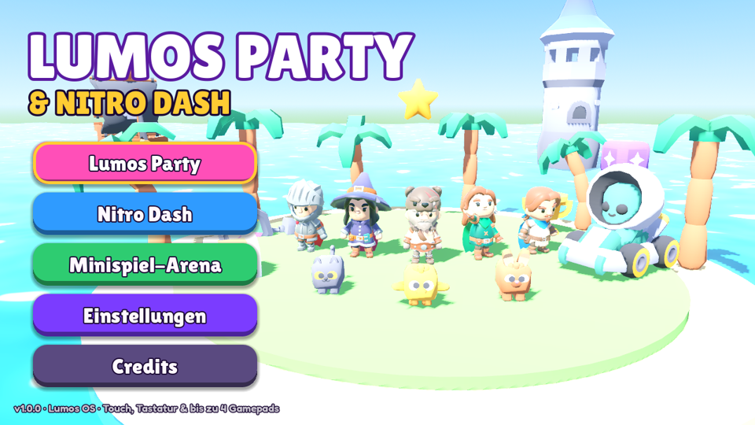
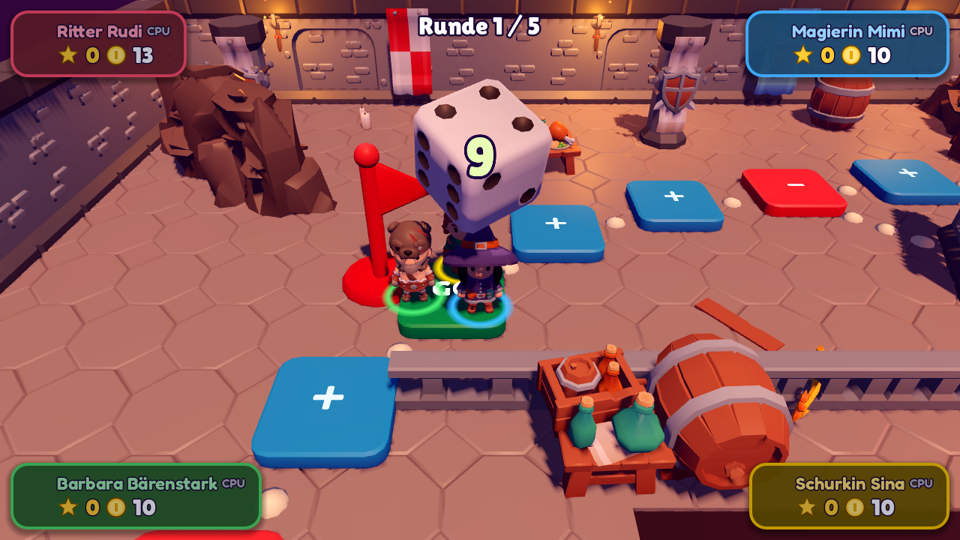
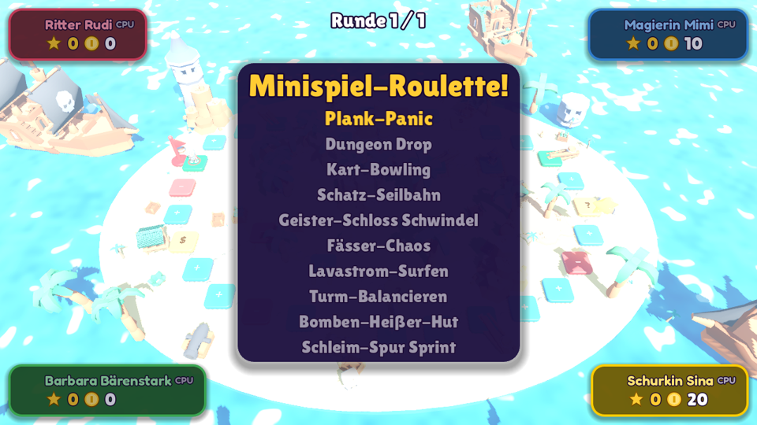
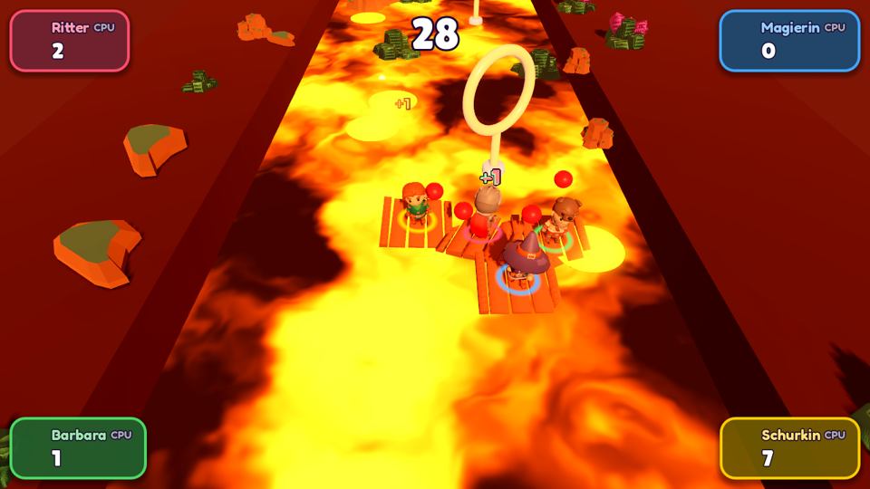
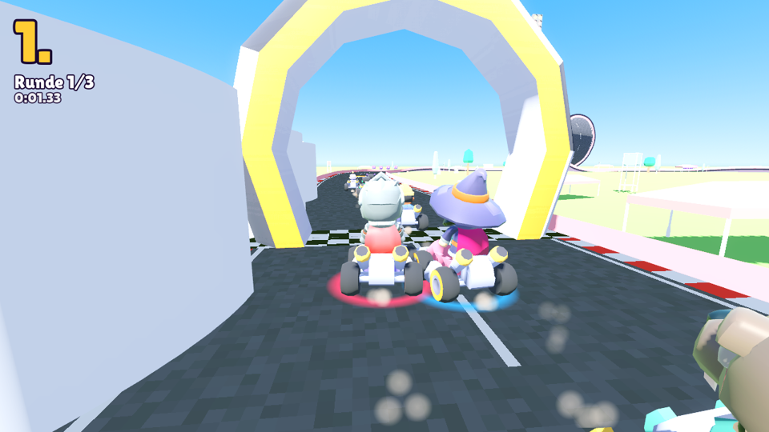
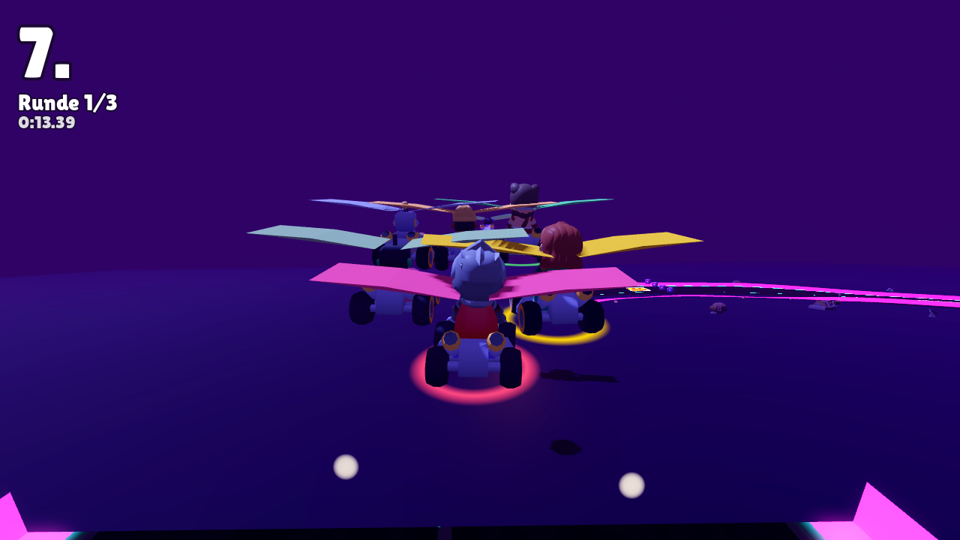
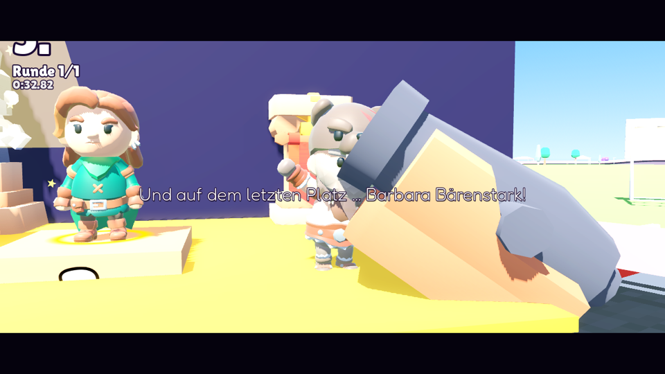

# Lumos Party & Nitro Dash

Der zweite exklusive Titel für **Lumos OS**: ein chaotisches 3D-Party-Brettspiel mit 10 Minispielen
(**Modus A – Lumos Party**) und ein High-Speed-Arcade-Racer (**Modus B – Nitro Dash**).
Gebaut mit **Godot 4.7** (GL-Compatibility/WebGL2), läuft auf dem Lumos One Handheld (Download aus dem
Lumos Store) und als installierbare **PWA** in jedem modernen Browser – mit Touch, Tastatur und bis zu
vier Gamepads.



| Brettspiel | Minispiel-Roulette | Lavastrom-Surfen |
|---|---|---|
|  |  |  |
| **Nitro Dash – Lumos-Ring** | **Neon-Vulkan (Gleiter)** | **Siegerehrung** |
|  |  |  |

## Inhalt

### Modus A – Lumos Party
* **10 Bretter** mit eigenem Look, eigenem Song und wechselnden Routen: Dungeon Deep · Sonnige Palmen-Bucht
  (Ebbe/Flut-Sandbank) · Sternen-Wolkenland (Zugbrücken, Wolken-Kanonen) · Geisterfriedhof (Geister-Taxi) ·
  Frostdorf (Eis-Rutschen) · Sternen-Sternwarte (Sternen-Tore, Spielzeugraketen) · **Glühwürmchen-Zauberwald**
  (Tag/Nacht-Wechsel jede Runde, nachts leuchten die Pilze den Weg) · **Wuschel-Wiesen** (Pusteblumen-Flüge,
  Schäfchen, Duell-Felder) · **Zuckerback-Torte** (Schoko-Rutschen, Kerzen-Fallen, Kirsch-Lifte) ·
  **Der Wolkenturm** (vertikal, siehe unten).
* **Felder:** Blau (+3), Rot (−3), Glücksrad-Kiste, Ereignisfelder je Brett, Händler, **Duell-Feld** (Gegner
  herausfordern), Lumos-Stern; im **Endspurt** zählen Felder doppelt und Spieler auf gleichem Feld duellieren sich.
* **Partner:** Hoppel, Piepsi, Mauzi, Hirschi, Muhla, Summsi, Kraxi, Robbi, Zippy und Bauli erscheinen auf dem
  Brett – wer sie zuerst erreicht, spielt ein Partner-Minispiel mit Startvorteil; Partner begleiten 3 Runden,
  verdoppeln Feld-Effekte und haben eigene Fähigkeiten (Würfelbonus, halber Sternpreis, Münzen klauen …).
* **Regeln:** Klassisch · **Profi** (12 Runden, angekündigte Bonussterne, Minispiel-Abstimmung, begrenzter Laden,
  Stern-Duelle) · **Blitz** (5 Runden, Start mit 50 Münzen, Stern und Doppelwürfel) · **Team** (2 gegen 2,
  geteilte Münzen und Sterne).
* **Minispiel-Ablauf wie im Vorbild:** Die Feldfarben bestimmen **Jeder gegen Jeden**, **1 gegen 3** oder
  **2 gegen 2** (Farbrad für Ereignisfelder), Team-Intro-Cutscene, Roulette bzw. Abstimmung; dazu **Duelle**,
  **Glücks-** und **Münz-Minispiele**, eine **Boss-Runde** (Pustebacke, der Wolkendrache) zur Brettmitte und der
  **Showdown-Dreikampf** im Endspurt.
* **38 Minispiele** (Kategorien siehe `docs/MINIGAMES.md`), alle auch einzeln in der **Minispiel-Arena** – neu:
  **Geister-Fotograf** (Taschenlampen-Intro, Geistervilla im Halbdunkel, langsam ladende Kamera, scharf/
  verwackelt/verzerrt je nach Timing), **Käse-Kloppe** (Mäuse auf wackelndem Federkäse, rollende Ball-Katzen,
  Packen & Werfen), **Pinguin-Curling** (3 Runden, Rammen erlaubt, Wischen), **Seifenblasen-Ballett**
  (Pumpen im Wechsel bläst andere weg, Blasen schrumpfen und werden rutschig, Überhitzen lässt die eigene
  platzen) und **Schlafwandler-Parcours** (blind über Balken, jede Sekunde ein Schnellwahl-Menü).
* **Lebendige Ränder** überall: `CritterLife` setzt Themen-Tierchen (Hasen, Küken, Füchse, Krabben, Pinguine,
  Katzen …) an jede Spielfläche, die herumhoppeln, schnüffeln, zuschauen und am Ende mitjubeln, dazu
  Schmetterlinge, Glühwürmchen oder Fledermäuse.

### Boss-Kämpfe (10 Bosse, je Brett einer)
Zur Brettmitte erscheint der Boss des Bretts – als freier Echtzeit-Arenakampf: laufen, springen, themenpassende
Wurfgeschosse sammeln und mit B werfen. Jede Fähigkeit wird sichtbar angekündigt (Bodenkreise, Bögen und Wellen
zum Drüberspringen, Sturmangriffe, zielsuchende Geschosse, Wind …); die Einzigartigkeit jedes Bosses ist ein Ort
in der Arena, den man taktisch nutzen muss. Phasen bei 66 % / 33 %, in der Wut-Phase Doppelangriffe; Schaden = Punkte.

| Brett | Boss | Fähigkeiten | Einzigartigkeit |
|---|---|---|---|
| Dungeon Deep | Ignis, der Seelenschmied | Lava-Atem, Schweifpeitsche, Schatz-Panzerung | brüchiger Boden |
| Palmen-Bucht | Klabautox, der Gezeiten-Leviathan | Tsunami-Welle, Blasen-Gefängnis, Scheren-Zange | Ebbe & Flut, Sandbänke |
| Wolkenland | Astraios, der Himmelsgolem | Sternschnuppen-Regen, Wolken-Kanonade, Gravitations-Umkehr | Wolken-Kanonen in seinen Rücken |
| Geisterfriedhof | Graf Grabstein & die Phantom-Meute | Seelenraub, Geister-Taxi-Umleitung, Nebelwand | Grabsteine machen ihn unverwundbar |
| Frostdorf | Yeti-König Frostbart | Eisrutschen-Chaos, Lawinen-Stampfer, Frostiger Atem | Schneebälle sprengen die Frost-Rüstung |
| Sternwarte | Galaxus, der Kosmos-Uhrmacher | Zeitsprung, Raketen-Feuersturm, Supernova-Impuls | Uhrwerke synchronisieren |
| Zauberwald | Noxumbra, die Schattenwurzel | Ewige Finsternis, Wurzel-Schlingen, Sporen-Wolke | nachts unsichtbar, nur Leuchtpilze treffen |
| Wuschel-Wiesen | Baaah-hemoth, das Wolken-Schaf | Rammbock-Sturm, Schäfchen-Flut, Pusteblumen-Orkan | Mini-Duelle auf Duell-Feldern |
| Zuckerback-Torte | Marzipan-Marquise & das Sahne-Monster | Karamell-Kleister, Kerzen-Flammenwerfer, Kirsch-Bombe | Kirsch-Lifte, Bombardement von oben |
| Der Wolkenturm | Zephyros, der Herrscher der Lüfte | Windböe, Aufwind-Wirbel, Pusteblumen-Sturm | Höhenbonus von Aufwind-Feldern |

Alle Boss-Modelle sind prozedural gebaut (`scripts/bosses/boss_model.gd`) und animiert; Testen:
`godot --path . -- --scene=res://scenes/minigames/BossBattle.tscn --cpu --boss=ignis`.

### Abenteuer & Modi
* **Der Wolkenturm** (Brettspiel in die Höhe): Wendelweg um einen verwunschenen Pflanzenturm mit Etagen,
  Ranken-Abkürzungen (Wegzoll), Wolkenlift, Aufwind-Feldern und Händler-Etagen. Wer den Gipfel erreicht,
  bekommt den Gipfelstern und rutscht über die Regenbogen-Rutsche wieder hinab; ab zwei Dritteln Höhe zählen
  Blau/Rot/Glück doppelt („Höhenbonus“), Windböen pusten Spieler zurück. Kamera folgt radial, Tiefendunst und
  ziehende Wolkenringe sorgen für Höhengefühl.
* **Das Kolosseum-Turnier**: 8 Teilnehmer (Spieler + Gast-Champions) im K.-o.-System – Viertelfinale,
  Halbfinale, Finale; jedes Match mit Spielerbeteiligung ist ein Duell-Minispiel. Einlauf durch versinkende
  Fallgitter mit Funken, Konfetti und Ansage. Das Publikum besteht nur aus Spielfiguren – einmal in einen
  Sprite-Atlas gerendert und als MultiMesh mit Jubel-Shader auf hohle Tribünenringe gestapelt (browserschonend).
* **Partyhelfer-Reise** (Einzelspieler): frei begehbare Pusteblumen-Insel, 10 Bewohner mit Minispiel-Aufträgen,
  10 versteckte Mini-Sterne, Wolkentor und Bosskampf gegen Pustebacke; Fortschritt wird gespeichert.
* **Rhythmus-Küche** (1–4, kooperativ): Fünf-Gänge-Menü im Takt – schnippeln, rühren, Pfannkuchen wenden,
  Gewürz-Duett, Torte verzieren – mit Team-Bonus und Küchen-Note S/A/B/C. Auch online.
* **Lumos-Athlon** (lokal 1–4 + CPUs, **online bis 20 Spieler**): Alle spielen gleichzeitig 12-Sekunden-Solo-
  Herausforderungen; jede Münze bringt ein Feld weiter, Glücks-/Pusteböen-/Sternenfelder, Pustebacke-Ereignis.

### Musik & Sound („Nintendo-Layered Dynamic Audio“)
* **Minispiel-Soundtracks 1–4** mit Abschnitten *Normal*, *Hurry-Up* und *Outro*: Schnitt auf das gemessene
  Beat-Raster, Loops in ganzen Takten mit überblendeter Naht, Hurry-Up per tonhöhenerhaltendem Time-Stretch auf
  die Ziel-BPM (Track 1: 120→145, Track 2: 110→138, Track 3: 120→140, Track 4: 115→145).
  Pipeline: `python3 -I tools/audio/build_music.py <ordner-mit-mp3s> .` → `assets/music/minigame/*.ogg`
  + `scripts/core/music_meta.gd`.
* **Musik-Direktor** (`Audio`): Beat-Uhr (`music_bpm()`, `music_beat()`, `upcoming_beats()`, Signale `beat`/`bar`),
  12 s vor Schluss **taktsynchroner Hurry-Up-Wechsel** am nächsten Taktanfang (mit sanfter Tempo-Rampe im letzten
  Takt), Outro am nächsten Schlag. Rhythmus-Spiele (Rhythmus-Tanz, Seilziehen, Schlummer-Sternchen,
  Rhythmus-Küche) richten ihre Noten nach dem laufenden Track – auch wenn er von Runde zu Runde wechselt.
* **Nur hochgeladene Soundtracks**: Brett- und Menümusik stammen ausschließlich aus den Ordnern Soundtracks1–3
  (keine prozedural erzeugte Hintergrundmusik). Jedes Brett lädt genau seinen Song (`assets/music/board/<brett>.ogg`),
  das Hauptmenü `menu.ogg`; Rennen nutzen Minispiel-Track 2 mit Hurry-Up in der letzten Runde.
  Crossfade bei jedem Szenenwechsel.
* **Micro-Feedback-Bibliothek**: Fokus-Plopp, Bestätigen, Zurück, Blättern, Umschalten, Münz-Zählkaskade,
  Würfel-Plopp, Zug-Glöckchen, Countdown-Fanfare, Triumph-Akkord, Verlierer-Seufzer (lolurio & Nomagician, CC BY 4.0).
* **Browser-Ton**: feste Bus-Konfiguration (`default_bus_layout.tres`) – im Web-Sample-Modus werden zur Laufzeit
  erzeugte Busse sonst nicht geroutet (Ursache für „kein Ton“), dazu Audio-Entsperrung bei jeder Geste.

### Welt & Animationen
* **Kein „Ende der Welt“**: `WorldKit.backdrop()` zieht Boden/Meer/Wolkenmeer bis zum Horizont, mit dunstigen
  Hügelketten, ziehenden Wolken, kreisenden Vögeln, Schmetterlingen/Schnee/Glühwürmchen und weichem Tiefendunst.
* **Minispiel-Auftritte**: Kanone zielt pro Schuss (Rohr schwenkt + richtet sich auf), Piratenschiff, Eisschollen,
  Wolken-Plumps oder Portal je nach Thema; Deko, die die Sicht verdeckt, wird ausgeblendet.
* **Siegerehrungen**: Goldregen, Feuerwerk oder Sternen-Schweben für den Sieger; Amboss, Sahnetorte,
  Regenwolke oder Hüpfpilz-Bruchlandung für den letzten Platz.
* **Abkürzungen**: Schließt eine Abkürzung, auf der jemand steht, fliegt Hummel Summsi ihn zur Abzweigung zurück.

### Eigene 3D-Avatare (Lumos-Profil)
* **Kein Editor** – das Modell kommt fertig aus dem Profil: Lumos One OS (`window.LumosOS.getAvatar()`), die
  Lumos Cloud (`GET /v1/profile/avatar` → `{url, version, forward, name}`) oder ein `avatar.url`-Feld im Profil.
  Zwischengespeichert in `user://avatars/`, neu geladen nur bei geänderter Version.
* **Automatisches Mapping** (`AvatarRetarget`): humanoide GLB/glTF-Modelle (Mixamo, VRM, Unity-Humanoid, Bip01,
  Rigify …) werden auf Heldengröße normiert, die Knochen dem KayKit-Rig_Medium zugeordnet und jede Pose eines
  unsichtbaren Referenzskeletts per Rest-Delta übertragen – laufen, sitzen im Kart, alle Reaktionen und
  Slapstick-Effekte funktionieren wie bei den Standardhelden. Erwartet wird ein Skelett in T-Pose.
* Der Avatar erscheint als zusätzlicher Held in der Spielerauswahl. Testen: `godot --path . -- --avatar=modell.glb`.

### Online
* **Online-Party auf dem Brett** (Lockstep: gemeinsamer Brett-Zufall, jede Spieler-Entscheidung wird vom
  Besitzer-Gerät verteilt), Nitro-Dash-Rennen, 21 netzwerkfähige Minispiele, Rhythmus-Küche und Athlon-Räume
  für bis zu 20 Geräte. Verlässt jemand das Spiel, übernimmt eine CPU.

### Animations-, Effekt- & Cutscene-System
* `CharacterRig` überträgt die **KayKit-Rig_Medium-Animationsbibliothek** (100+ Clips) auf alle Helden,
  dazu **Squash & Stretch**, Antizipation und ein prozeduraler **Bone-Rig-Modifier** (`SkeletonModifier3D`):
  Torkeln, Zittern, Kopfschütteln, Triumph-Pose, Blickkontakt mit der Kamera, Lenkpose im Kart.
* **28 Slapstick-Reaktionen** als editierbare Ressourcen in `assets/animations/reactions/` (Jubeln, Frust-Hämmern,
  Ruß-Gesicht, Benommenheit mit Cartoon-Sternen, Ausrutschen …).
* Untergrund-abhängige Partikel (Dungeon-Geröll, Sandwirbel, Wasserspritzer, Funken, Schleim, Glut).
* **CutsceneManager** (Event-Bus-gesteuert) mit Tween-Kamera, Orbit, Spline-Flug, Dyna-Zoom, Shake,
  Letterbox und Countdown. Cutscenes in `scenes/cutscenes/`: Runden-Intro (360°-Flug, schlafende Gegner,
  zuckende Fallen, Startspieler grinst in die Kamera), Minispiel-Teaser (Spieler per Kanone ins Bild),
  Sieger-Moment, Stern-Erhalt, Planken-Katapult, Fluch-Tausch, Rennen-Intro, Item-Zeitlupe und das
  **Podest-Drama** (goldene Spotlight-Dusche, Konfetti-Kanonen – und ein Amboss für den Letzten).

## Steuerung

| Aktion | Tastatur | Gamepad (Lumos/Xbox/Switch) | Touch |
|---|---|---|---|
| Bewegen / Lenken | WASD / Pfeile | linker Stick / Steuerkreuz | schwebender Stick (linke Hälfte) |
| A – Springen / Würfeln / OK | Leertaste, Enter | A | grüner Button |
| B – Aktion / Schubsen / Nein | K | B | roter Button |
| Item (Nitro Dash) | E | X oder LB/LT | gelber Button |
| Drift (Nitro Dash) | Shift / Leertaste | RB oder RT | blauer Button |
| Pause | Esc | Start | ‖ |

* **Menüs wie auf der Konsole:** Steuerkreuz/Stick bewegen den Fokus, **A bestätigt, B geht zurück** – überall
  (auch Dialoge, Pausenmenü, Lobby). Nach einem Mausklick holt sich der erste Pad-Druck automatisch den Fokus.
* **Pausenmenü** (Start/Esc/‖) in Brett, Minispielen, Rennen und Modi: Weiter, Lautstärke, Steuerung, Zum Menü
  (online läuft das Spiel weiter, dort „Raum verlassen“).
* **Touch-Steuerelemente erscheinen nur auf echten Mobilgeräten** (Handy/Tablet, iPadOS); Desktop-Browser, App
  und Laptops mit Touchscreen zeigen sie nicht. Layout in **Einstellungen → Layout anpassen** (Größe/Deckkraft).
* **Nitro Dash** fährt sich wie ein klassischer Arcade-Kart: weich ansprechende Lenkung mit Trägheit,
  Federung (Einfedern bei Landungen, Nicken beim Gasgeben/Bremsen, Wanken in Kurven) und ein Regler
  **Einstellungen → Kart-Lenkung** für die Empfindlichkeit.

Vibration läuft über Gamepad-Rumble bzw. `navigator.vibrate`. CPU-Züge lassen sich mit gehaltenem A vorspulen.

## Entwicklung

Voraussetzung: **Godot 4.7.2** (Standard-Build reicht), Python 3 mit `numpy` (nur für Musik/SFX-Generierung).

```bash
godot --path . --import
```

```bash
godot --path .
```

Hilfswerkzeuge:

| Befehl | Zweck |
|---|---|
| `python3 tools/asset_pipeline.py --check` | Asset-Inventur, glTF-Validierung, `.gdignore`-Regeln, `docs/ASSET_INVENTORY.md` |
| `python3 tools/validate_catalog.py` | prüft alle Pfade im Asset-Katalog (`autoload/assets.gd`) |
| `python3 -I tools/audio/build_music.py <mp3-ordner> .` | schneidet/taktet die hochgeladenen Soundtracks (einzige Musikquelle) |
| `python3 tools/compose_sfx.py` | erzeugt Cartoon-SFX (keine Musik) |
| `python3 tools/gen_reactions.py` | erzeugt die Reaktionsbibliothek |
| `godot --headless --path . res://tools/dev/Check.tscn` | lädt alle Skripte/Szenen (Fehlerprüfung) |
| `tools/dev/test_minigames.sh <ordner>` | spielt alle Minispiele mit 4 CPUs an und speichert Screenshots |

Test-Start-Optionen (nach `--`): `--scene=res://scenes/minigames/HotBomb.tscn --cpu --touch --board=pirates
--rounds=1 --track=neon_volcano --laps=1 --shots=5,10 --quit=20 --debug-ai`.

## Web/PWA-Build, Vercel & Lumos OS

```bash
./godot --headless --export-release "Web" web/index.html
```

Build-Dateien (`web/index.*`, `.pck`, `.wasm`, `version.json`, ZIPs) sind in `.gitignore` und werden **nicht**
eingecheckt – lokal per Python-Server testen, das Deployment baut GitHub Actions selbst.

* **Live-Version (GitHub Pages)**: https://rxplxcxd.github.io/lumos-party-game/ – wird bei jedem Push auf `main`
  automatisch gebaut und veröffentlicht (Workflow `.github/workflows/build-web.yml`). Einmalig muss unter
  *Settings → Pages* bei *Source* „GitHub Actions“ gewählt sein (alternativ Secret `PAGES_TOKEN` mit
  Administration- + Pages-Schreibrecht, dann aktiviert der Workflow Pages selbst).
* **Musik im Web** liegt nicht im `index.pck`, sondern als `music/…ogg` neben dem Spiel (kopiert von
  `tools/postexport_pwa.py`) und wird zur Laufzeit gestreamt – das Start-Paket ist dadurch ~30 MB kleiner.
* **Assets**: Im Repo liegen nur noch Runtime-Formate (GLB/glTF, PNG-Texturen, OGG). Neue Asset-Pakete mit
  `python3 tools/asset_pipeline.py` einsortieren; Ordner mit `.gdignore` (FBX/OBJ/Previews …) danach löschen.
* **Laden im Browser**: Der Ladebildschirm (`web/shell.html`) lädt `index.wasm`/`index.pck` selbst – mit
  Stillstand-Erkennung, Wiederholungen und „Neu laden“-Knopf; der Service Worker (`web/sw.js`) greift online
  nicht in diese Dateien ein und wird erst nach dem Spielstart registriert.
* **Logo & Icons** stammen aus Spiel-Assets:
  `xvfb-run -a ./godot --path . res://tools/dev/Run.tscn -- --dev-script=res://tools/brand/render_logo.gd --out=/tmp/logo`
  und danach `python3 tools/brand/make_icons.py /tmp/logo/logo_render.png`.

### Versionierung
Vor dem Release **1.1.x** (1.1.1 … 1.1.9), danach **1.2** als offizieller Release. Version immer mit
`python3 tools/version.py <version>` (oder `--next`) setzen – das hält `project.godot`, `lumos-app.json` und
die Anzeige im Ladebildschirm synchron. Commit-Betreff beginnt mit `vX.Y.Z:`; Änderungen in `CHANGELOG.md`.

```bash
cd web && python3 -m http.server 8080
```

* `web/` ist direkt auf **Vercel** deploybar (MIME-Typen für `.wasm`/`.pck`, Cache-Header für den Service Worker,
  Popup-taugliche COOP-Policy für das Google-Login) – Details und Lumos-Sideload/Kiosk-Installer in
  [docs/DEPLOYMENT.md](docs/DEPLOYMENT.md), Online-Architektur in [docs/ONLINE.md](docs/ONLINE.md).
* Exportliste neu erzeugen (nach neuen Modellen/Szenen):
  `./godot --headless --path . res://tools/dev/Run.tscn -- --dev-script=res://tools/export_list.gd`
* `python3 tools/postexport_pwa.py web --zip` erzeugt `version.json`, `lumos-app.json` und das Store-Paket
  `build/lumos-party-web.zip`.
* Lumos OS: `python3 tools/lumos/install_lumos.py --launch` installiert und registriert das Spiel über `lumosd`.
* **GitHub Actions**: Import → Skriptprüfung → Online-Test (2 Instanzen) → Web-Export → Browser-Rauchtest
  (inkl. Audio) → Linux-Export → GitHub Pages / Vercel / Release (`v*`).

## Projektstruktur

```
autoload/        EventBus, Game, Assets, Audio, InputHub, Juice, FX, CutsceneManager, Router, Account, Avatars, Net
scripts/core/    CharacterRig, SlapstickModifier, ReactionClip, AvatarRetarget, CritterLife, RiverLife, WorldKit, …
scripts/modes/   Partyhelfer-Reise, Lumos-Athlon, Kolosseum-Turnier
scripts/party/   Brett-Daten, Brett-Baukasten, Brettspiel-Logik
scripts/minigames/  MinigameBase + 38 Minispiele
scripts/racer/   TrackDefs, RaceTrack, Racer (Fahrphysik + KI), NitroDash (Rennleitung, Items, HUD)
scripts/ui/      Boot, Hauptmenü, Touch-Steuerung, Theme, Icons, Glücksrad
scenes/          boot, menu, party, minigames, racer, cutscenes
assets/          Original-Assetpakete (3d/, audio/) + animations/, music/, sfx/, fonts/, shaders/
web/             HTML-Shell, Manifest, Icons der PWA
tools/           Asset-Pipeline, Generatoren, Export, Tests
docs/            ASSET_INVENTORY.md, ARCHITECTURE.md, Screenshots
```

Details zur Technik: [docs/ARCHITECTURE.md](docs/ARCHITECTURE.md) · Asset-Nutzung: [docs/ASSET_INVENTORY.md](docs/ASSET_INVENTORY.md)

## Lizenzen

3D-Modelle, Sounds und Icons: Kenney und KayKit (CC0). Schriften: Lilita One und Fredoka (SIL OFL 1.1,
siehe `assets/fonts/`). Engine: Godot (MIT). Soundtrack und Cartoon-SFX sind prozedural erzeugt.
